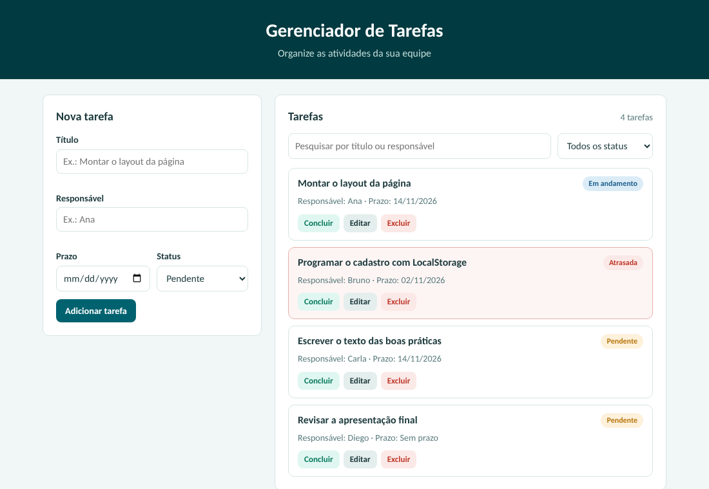

# 📋 Gerenciador de Tarefas para Pequenas Equipes

Projeto Integrador: Boas Práticas de Desenvolvimento de Software (Segunda Etapa).

Aplicação web simples para criar, atribuir e acompanhar tarefas em equipe. Feita com HTML, CSS e JavaScript puro, sem banco de dados externo: os dados ficam salvos no LocalStorage do navegador.



## 🎯 Problema e objetivo

Pequenas equipes, grupos de estudo e times de projetos acadêmicos costumam organizar tarefas de forma informal (mensagens, planilhas soltas ou de memória), o que gera retrabalho, prazos perdidos e falta de clareza sobre quem é responsável por cada atividade.

O objetivo da aplicação é permitir criar, atribuir e acompanhar tarefas em equipe de forma simples.

## ✨ Funcionalidades

- ➕ Cadastro de tarefas com título, responsável, prazo e status
- 📄 Listagem de todas as tarefas, com selo de status
- ✏️ Edição de tarefas
- 🗑️ Exclusão com confirmação
- ✅ Concluir e reabrir tarefas com um clique
- 🔍 Pesquisa por título ou responsável (ignora maiúsculas e acentos)
- 🏷️ Filtro por status: pendente, em andamento, concluída ou atrasada
- ⏰ Destaque automático de tarefas com prazo vencido
- 📱 Layout adaptável para celular

## 🗂️ Estrutura do projeto

```
.
├── index.html
├── css/
│   ├── variaveis.css
│   ├── base.css
│   ├── formulario.css
│   ├── botoes.css
│   ├── lista.css
│   └── responsivo.css
├── js/
│   ├── armazenamento.js
│   ├── regras.js
│   ├── validacao.js
│   ├── interface.js
│   └── main.js
├── img/
└── README.md
```

- `variaveis.css`: cores e medidas em um só lugar
- `base.css`: estilo geral da página
- `formulario.css`, `botoes.css`, `lista.css`: um arquivo por parte da tela
- `responsivo.css`: ajustes para celular
- `armazenamento.js`: leitura e gravação no LocalStorage
- `regras.js`: regras das tarefas (atraso, filtros, datas)
- `validacao.js`: validação dos campos do formulário
- `interface.js`: tudo que mexe na tela
- `main.js`: junta as partes e liga os eventos

## 💾 Armazenamento dos dados

As tarefas são salvas no LocalStorage, na chave `gerenciador-tarefas:v1`. Os dados ficam apenas no navegador e no computador em que foram cadastrados. Limpar os dados do site apaga as tarefas.

## 🛠️ Boas práticas aplicadas

- 🧩 Código separado por responsabilidade: HTML, CSS e JavaScript em arquivos próprios, divididos por assunto (armazenamento, regras, validação, interface)
- 🏷️ Nomes claros e funções pequenas, cada uma com uma responsabilidade (`salvarTarefa`, `validar`, `filtrar`)
- ✔️ Validação dos dados, com mensagem de erro ao lado do campo
- 🔒 Textos digitados são inseridos como texto puro, sem interpretar HTML
- 🛡️ Leitura do LocalStorage protegida contra falhas, e chave com versão para mudanças futuras
- ♿ Interface acessível e responsiva: campos com rótulo, foco visível e botões descritivos
- 🎨 CSS organizado com variáveis para cores e medidas
- 🙋 Confirmação antes de excluir e botão para cancelar uma edição